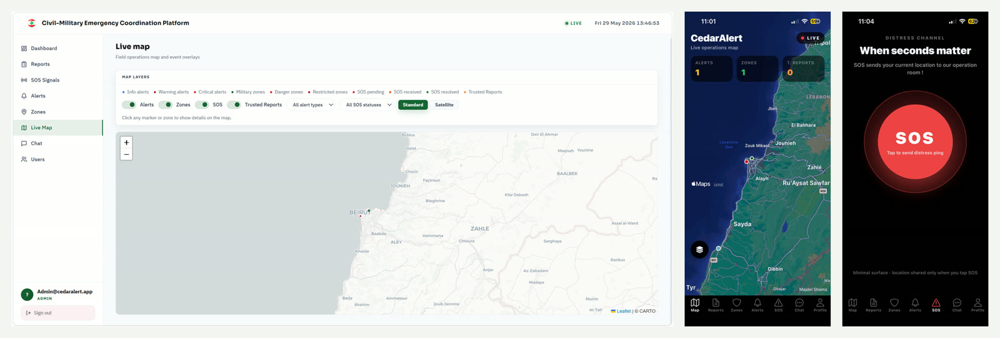
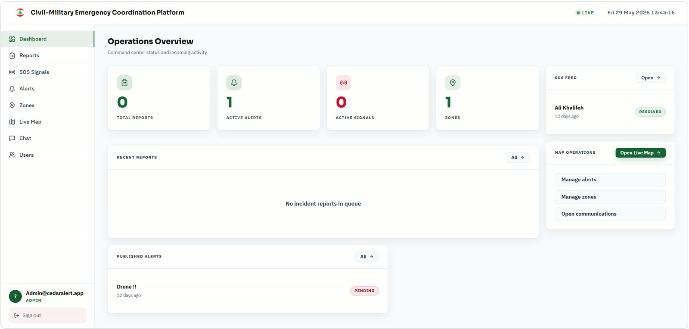
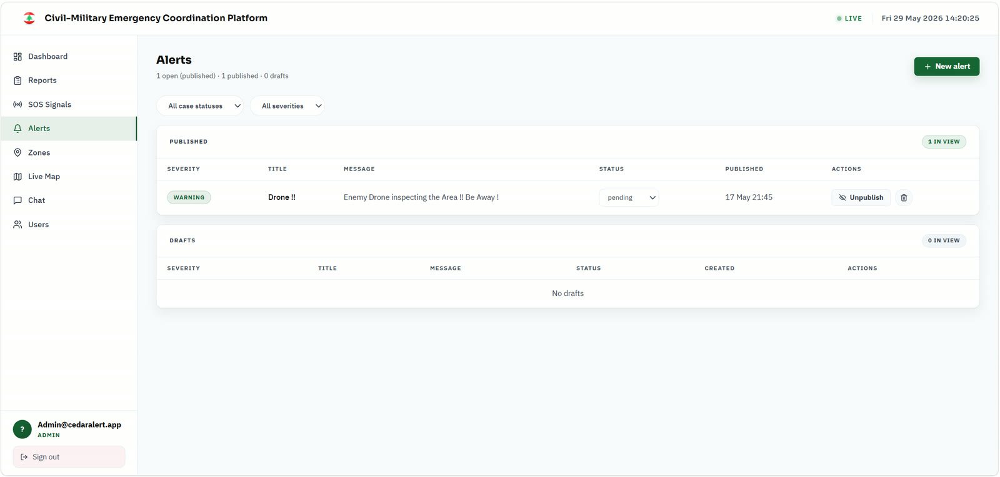
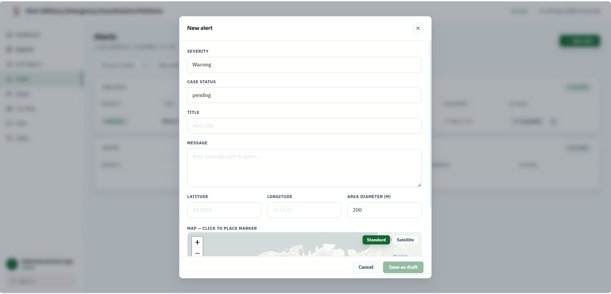
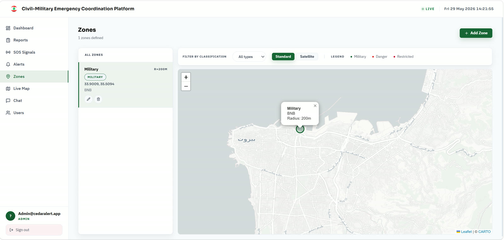
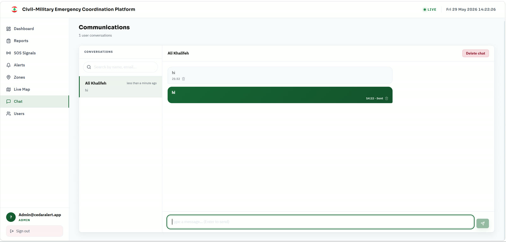
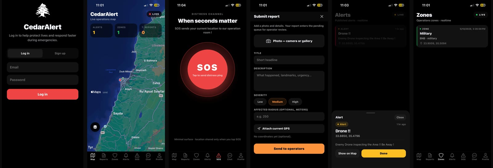
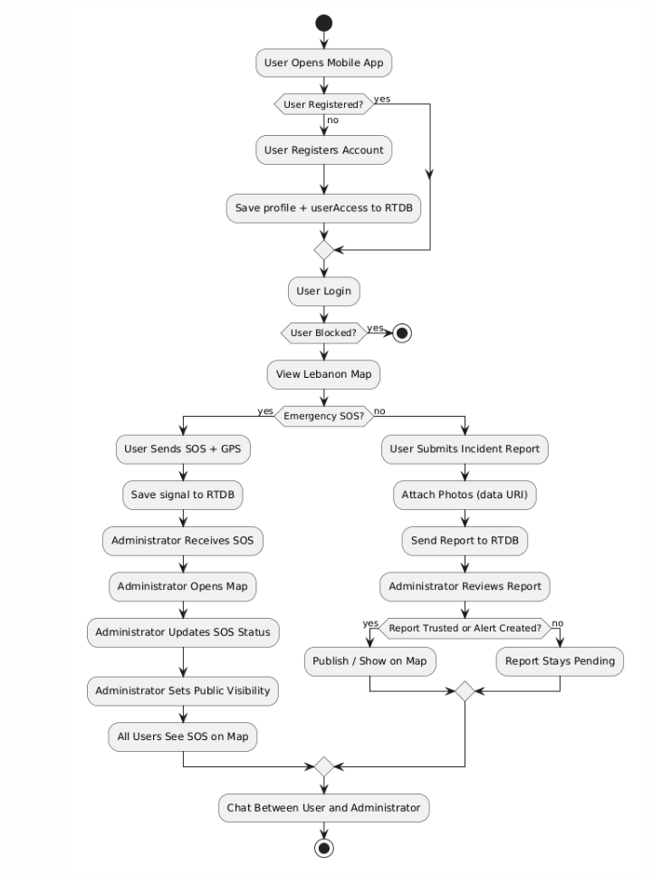
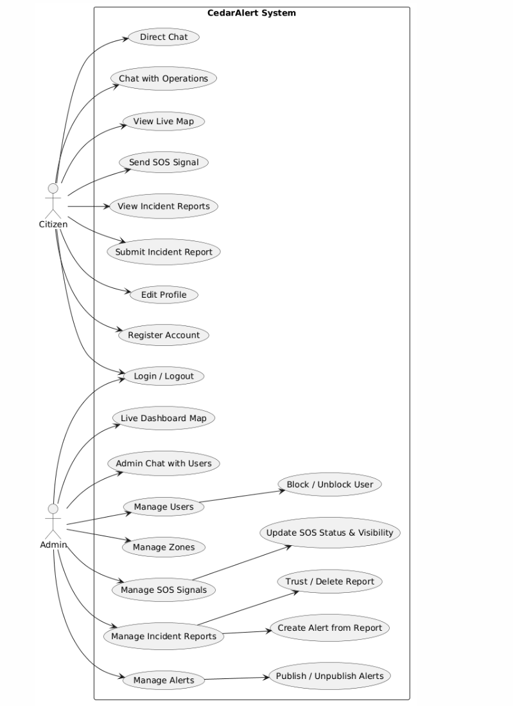

# 🇱🇧 CedarAlert

**A civil–military emergency coordination platform for Lebanon: a web command center for operators and a mobile app for citizens, connected in real time.**

## The problem

During emergencies in Lebanon, reports reach civil defence and military coordination cells through phone calls and social media. That information is unverified, unstructured and hard to put on a map, and phone lines don't scale when many people call at once.

## The solution

One platform with two apps sharing a real-time database. Citizens use the mobile app to send an SOS with their location, report incidents with photos, and receive official alerts. Operators use the web command center to verify reports, publish alerts, mark danger zones and coordinate, all on a shared live map.

## Key features

**Mobile app (citizens)**
- One-tap **SOS** that sends the current GPS location.
- **Incident reports** with photo, severity, description and location.
- **Live map** of alerts, zones and verified reports.
- **Alerts and zones** feeds, with a "show on map" shortcut.
- **Chat** with the operations room, with delivered and read receipts.

**Web command center (operators)**
- **Operations dashboard** with live counts and recent activity.
- **SOS management:** update each signal's status and choose what the public sees.
- **Report review:** mark reports as trusted or turn them into alerts.
- **Alerts and zones:** create them with severity, location and radius directly on the map.
- **Live map** with filterable layers, in standard or satellite view.
- **User management** and chat with any user.

## Screenshots

**Web command center**

| Alerts | New alert |
| --- | --- |
|  |  |

| Zones | Operations chat |
| --- | --- |
|  |  |

**Mobile app**

**System design**

<b>Use case diagram</b>

## Tech stack

| | |
| --- | --- |
| **Languages** | TypeScript, JavaScript, CSS |
| **Web command center** | React 18, Vite, React Router, Leaflet maps |
| **Mobile app** | React Native, Expo, React Navigation, react-native-maps |
| **Backend** | Firebase Authentication, Firebase Realtime Database, Cloud Functions |
| **Design** | UML: use case, sequence and activity diagrams |

---

> **Source code is private.** For hiring or academic review, code access is available on request: DM [@cedarcode.lb](https://instagram.com/cedarcode.lb) or visit [cedarcodesite.com](https://cedarcodesite.com).

© 2026 Ali Khalifeh. All rights reserved.
